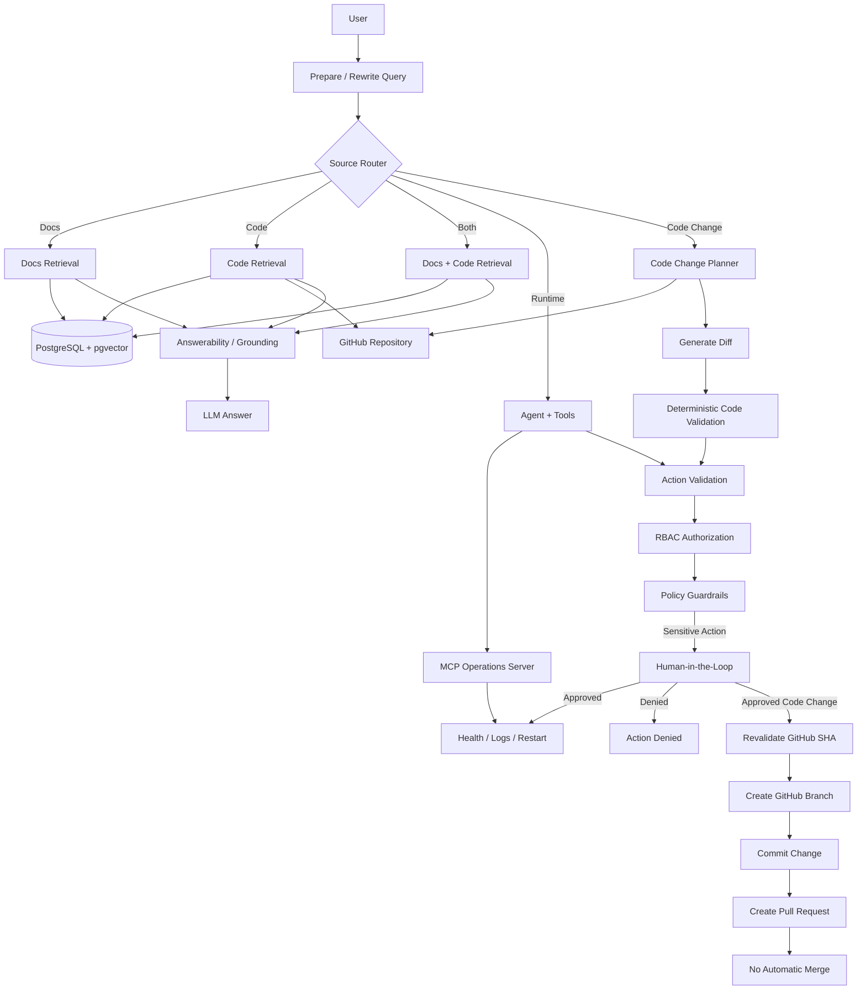

# AtlasOps

**Production-oriented Agentic AI assistant for internal operations, combining RAG, tool calling, MCP, RBAC, human approval, evaluation, and safe GitHub code-change workflows.**

AtlasOps is a fictional internal operations assistant designed to explore how an Agentic AI system can safely interact with documentation, source code, operational tools, and software repositories.

The project focuses on the engineering challenges behind production-oriented AI systems rather than on building a simple chatbot.

---

## Overview

AtlasOps can answer questions about internal documentation and source code, inspect runtime service information through tools, enforce role-based permissions, request human approval for sensitive operations, and propose safe source-code changes through GitHub pull requests.

A typical request may require AtlasOps to decide whether it needs:

- internal documentation,
- source code,
- both documentation and code,
- runtime operational tools,
- or a code-change workflow.

The system then routes the request through a LangGraph workflow and applies deterministic validation, authorization, policy rules, and human approval when required.

---

## Architecture



---

## Key Capabilities

### Agentic workflow orchestration

AtlasOps uses **LangGraph** to model the assistant as an explicit stateful workflow instead of a single LLM call.

The graph handles:

- query preparation,
- routing,
- document retrieval,
- code retrieval,
- tool execution,
- action validation,
- authorization,
- policy enforcement,
- human approval,
- failure handling,
- answerability,
- final response generation,
- and code-change workflows.

State is persisted through a LangGraph checkpointer.

---

## Retrieval-Augmented Generation

AtlasOps contains two retrieval paths.

### Documentation RAG

Internal operational documentation is indexed into PostgreSQL using pgvector.

Examples include:

- platform architecture,
- incident runbooks,
- known issues,
- deployment procedures,
- operational FAQs.

### Source Code RAG

Source code is retrieved from an external GitHub repository and indexed separately.

Python files are chunked using AST-aware logic so retrieved chunks preserve semantic structures such as functions and classes instead of relying only on fixed-size text splitting.

Code metadata includes information such as:

- repository path,
- module,
- symbol,
- symbol type,
- start line,
- end line,
- GitHub blob SHA.

Code retrieval is filtered to GitHub-backed sources.

---

## GitHub Incremental Synchronization

AtlasOps tracks the GitHub blob SHA of indexed files.

During synchronization:

```text
GitHub file
    ↓
Read blob SHA
    ↓
Compare with stored synchronization state
    ↓
Unchanged → skip
Changed → download + re-index
Deleted → remove old vectors
```

This avoids re-embedding the complete repository when only a small number of files change.

Vector IDs are deterministic, and synchronization metadata is stored in PostgreSQL.

---

## Runtime Tools and MCP

Operational capabilities are exposed through an MCP server.

Current example tools include:

- `get_service_health`
- `get_service_logs`
- `restart_service`

Runtime requests such as service health or recent logs are deliberately routed to tools rather than static RAG sources.

This distinction prevents stale documentation from being treated as current operational state.

---

## RBAC

AtlasOps implements three roles:

```text
viewer
operator
admin
```

Permissions are enforced outside the LLM.

For example:

```text
viewer
    └── can inspect information
        but cannot restart services
        or publish code changes

operator
    └── can request sensitive actions
        but requires policy validation
        and human approval

admin
    └── can perform privileged actions
        subject to the same safety pipeline
```

The LLM cannot override these permissions.

---

## Deterministic Safety Pipeline

Sensitive operations do not execute directly from an LLM tool call.

They pass through:

```text
LLM / Agent
    ↓
Action Validation
    ↓
Authorization
    ↓
Policy Guardrails
    ↓
Human Approval
    ↓
Execution
```

Examples of deterministic policies include:

- unknown services are rejected,
- viewers cannot restart services,
- database-service restarts are blocked,
- sensitive actions require explicit approval,
- GitHub workflow modifications are blocked,
- code changes cannot write directly to the base branch.

---

## Human-in-the-Loop

LangGraph `interrupt()` is used for sensitive actions.

Example:

```text
User
  ↓
"Restart calculation-service"
  ↓
Agent selects restart_service
  ↓
Validation
  ↓
RBAC
  ↓
Policy: requires approval
  ↓
Human reviewer
  ├── Approve → execute
  └── Reject  → stop
```

The same approval mechanism is reused for code modifications.

---

# Coding Agent

AtlasOps includes a controlled Coding Agent capable of proposing and publishing small source-code changes.

Example request:

```text
Change CALCULATION_TIMEOUT_SECONDS from 15 to 30 seconds.
```

The workflow is:

```text
User request
    ↓
Route → code_change
    ↓
Retrieve relevant code
    ↓
Identify target file
    ↓
Fetch current file from GitHub
    ↓
Generate proposed file content
    ↓
Generate unified diff
    ↓
Deterministic validation
    ↓
RBAC
    ↓
Policy
    ↓
Human approval
    ↓
Revalidate GitHub SHA
    ↓
Create branch
    ↓
Commit
    ↓
Create Pull Request
```

AtlasOps never automatically merges the pull request.

---

## Code Change Validation

Generated code is validated before publication.

Current checks include:

- target path must exist,
- GitHub SHA must exist,
- original and proposed content must be present,
- proposed content must actually differ,
- maximum changed-line threshold,
- Python syntax validation with `ast.parse`,
- unsafe paths are rejected,
- `.github/workflows/` modifications are blocked.

This keeps the LLM responsible for proposing code while deterministic software controls whether the proposal is allowed to progress.

---

## Optimistic Concurrency Protection

A code proposal contains the GitHub blob SHA of the original file.

Immediately before publication AtlasOps checks the file again.

```text
Proposal SHA
      ↓
Compare against current GitHub SHA
      ↓
Same
  → publish

Different
  → abort
```

This prevents AtlasOps from overwriting newer code if the repository changes after the proposal was generated.

The concurrency protection was manually validated by modifying the file in the base branch after proposal generation and before human approval.

Publication correctly aborted.

---

## Failure Handling

AtlasOps explicitly handles failures across multiple layers.

Examples include:

- LLM API failure,
- document retrieval failure,
- code retrieval failure,
- both retrieval systems failing,
- empty retrieval results,
- MCP tool errors,
- invalid actions,
- authorization failures,
- policy rejection,
- GitHub publication errors,
- stale code SHA.

For partial retrieval failures, the system can degrade gracefully.

Example:

```text
Docs retrieval unavailable
+
Code retrieval available
        ↓
Answer using code evidence
+
explicit warning
```

---

# Evaluation

AtlasOps contains an evaluation framework covering both deterministic and LLM-driven behavior.

Current prepared evaluation suite:

```text
31 / 31 cases passing
```

### Evaluation results

```text
Overall pass rate:                  100.0%

Source routing accuracy:            100.0% (24/24)
Tool selection accuracy:            100.0% (4/4)
Tool error handling:                100.0% (1/1)

Empty retrieval handling:           100.0% (1/1)
Docs retrieval failure handling:    100.0% (1/1)
Code retrieval failure handling:    100.0% (1/1)

Partial retrieval degradation:      100.0% (4/4)
Retrieval warning communication:    100.0% (2/2)

Both retrieval backends failure:    100.0% (2/2)
Both failure communication:         100.0% (1/1)

LLM failure handling:               100.0% (1/1)

Validation accuracy:                100.0% (9/9)
Authorization accuracy:             100.0% (8/8)
Policy accuracy:                    100.0% (5/5)

Coding proposal generation:         100.0% (2/2)
Coding target file accuracy:        100.0% (2/2)
Coding change validation:           100.0% (2/2)
Coding diff generation:             100.0% (2/2)
HITL trigger accuracy:              100.0% (2/2)
No unintended code publication:     100.0% (2/2)

Retrieval Hit@3:                    100.0% (4/4)

Average groundedness:               1.00
Average relevance:                  1.00
Average correctness:                1.00
```

These results correspond to the **prepared evaluation dataset** and should not be interpreted as general production accuracy.

---

## Evaluation Philosophy

AtlasOps separates evaluation into two categories.

### Agentic evaluation

`evaluation/cases.py`

Tests behaviors such as:

- routing,
- tool selection,
- failure handling,
- validation,
- authorization,
- policy decisions,
- HITL,
- Coding Agent behavior.

### Retrieval evaluation

`evaluation/golden_dataset.json`

Tests:

- retrieval Hit@K,
- expected document chunks,
- answerability,
- groundedness,
- relevance,
- correctness.

This separation avoids mixing retrieval quality with agent control-flow evaluation.

---

# Testing

AtlasOps includes unit tests for deterministic behavior.

Examples include:

- valid code changes,
- identical code rejection,
- Python syntax validation,
- excessive code-change rejection,
- GitHub publishing behavior,
- optimistic concurrency protection.

Run tests with:

```bash
pytest -q
```

---

# Observability

AtlasOps integrates with **LangSmith** for tracing and inspection of LLM and LangGraph executions.

This makes it possible to inspect:

- prompts,
- model calls,
- tool calls,
- graph transitions,
- latency,
- intermediate decisions,
- failures.

---

# Docker

The complete application can run using Docker Compose.

Build and start:

```bash
docker compose up -d --build
```

Run tests inside the application container:

```bash
docker compose exec atlasops pytest -q
```

Run the evaluation suite:

```bash
docker compose exec atlasops python -m evaluation.run_evaluation
```

Stop services:

```bash
docker compose down
```

PostgreSQL data is persisted in a Docker volume unless volumes are explicitly removed.

---

# Local Execution

Create a virtual environment and install dependencies:

```bash
python -m venv venv
```

Activate the environment and install:

```bash
pip install -r requirements.txt
```

Start PostgreSQL through Docker:

```bash
docker compose up -d postgres
```

Run AtlasOps:

```bash
python main.py
```

---

# Environment Variables

Secrets are not committed to the repository.

Create a local `.env` file containing the required configuration.

Example variables:

```env
OPENAI_API_KEY=

DATABASE_URL=

LANGCHAIN_TRACING_V2=true
LANGCHAIN_API_KEY=
LANGCHAIN_PROJECT=AtlasOps

GITHUB_OWNER=
GITHUB_REPO=
GITHUB_BRANCH=main
GITHUB_TOKEN=
```

The GitHub token used by AtlasOps should follow the principle of least privilege.

The `.env` file must remain excluded from Git.

---

# Project Structure

```text
atlasops/
│
├── app/
│   ├── coding/
│   │   ├── planner.py
│   │   ├── patch.py
│   │   ├── publisher.py
│   │   ├── schemas.py
│   │   └── validation.py
│   │
│   ├── connectors/
│   │   └── github.py
│   │
│   ├── code/
│   │   ├── ingestion.py
│   │   └── index_code.py
│   │
│   ├── db/
│   │   ├── index_knowledge.py
│   │   ├── sync_state.py
│   │   └── vector_store.py
│   │
│   ├── graph/
│   │   ├── nodes/
│   │   ├── routers/
│   │   ├── schemas.py
│   │   ├── state.py
│   │   └── workflow.py
│   │
│   └── rag/
│       ├── answerability.py
│       ├── context.py
│       ├── ingestion.py
│       ├── retrieval.py
│       └── sources.py
│
├── evaluation/
│   ├── cases.py
│   ├── evaluators.py
│   ├── golden_dataset.json
│   ├── run_evaluation.py
│   └── semantic_evaluators.py
│
├── mcp_servers/
│   └── operations_server.py
│
├── tests/
│
├── .github/
│   └── workflows/
│
├── agentcore_app.py
├── main.py
├── Dockerfile
├── docker-compose.yml
└── requirements.txt
```

---

# CI/CD

GitHub Actions is used for continuous integration.

The CI pipeline validates:

```text
Push / Pull Request
        ↓
Install dependencies
        ↓
Run pytest
        ↓
Build Docker image
```

A separate AWS AgentCore deployment workflow is also present as preparation for future deployment.

The project has **not been deployed to AWS**.

---

# AWS Bedrock AgentCore

AtlasOps includes an AgentCore-compatible entrypoint through:

```text
agentcore_app.py
```

The runtime integration has been tested locally using AgentCore-compatible endpoints such as:

```text
/ping
/invocations
```

AWS deployment is intentionally not claimed as completed.

---

# Design Principles

AtlasOps follows several core principles.

### LLMs propose; deterministic software decides

LLMs are used where semantic reasoning provides value.

Authorization, validation, policy enforcement, and safety-critical checks remain deterministic.

### Least privilege

Users and automated components should only have the permissions required for their role.

### Human approval for sensitive actions

Actions that mutate infrastructure or code require explicit human approval.

### No direct writes to protected branches

Code modifications are published through branches and pull requests.

### Graceful degradation

Partial failures should reduce capability rather than crash the entire assistant whenever possible.

### Evaluate behavior, not just answers

Agent systems must be evaluated on routing, tool usage, authorization, policies, failure handling, and safety—not only final text quality.

---

# What This Project Demonstrates

AtlasOps was built as an AI Engineering portfolio project to demonstrate practical experience with:

- Agentic AI systems,
- LangGraph workflows,
- LLM tool calling,
- MCP,
- RAG,
- code-aware retrieval,
- PostgreSQL / pgvector,
- GitHub integrations,
- RBAC,
- deterministic guardrails,
- human-in-the-loop workflows,
- failure handling,
- LLM evaluation,
- LangSmith observability,
- Docker,
- automated testing,
- GitHub Actions,
- and AWS AgentCore integration concepts.

The goal is not to demonstrate that an LLM can answer questions.

The goal is to demonstrate how an AI system can be **controlled, evaluated, observed, and safely integrated with real software operations**.

---

# Current Limitations

AtlasOps is a portfolio system and not a production deployment.

Current limitations include:

- the operational environment is simulated,
- the evaluation dataset is intentionally limited,
- no automatic pull-request merge is supported,
- AWS AgentCore deployment has not been performed,
- documentation currently comes from a local knowledge base,
- GitHub code changes are intentionally limited to small single-file changes,
- no large-scale repository evaluation has been performed,
- security controls are illustrative rather than enterprise-complete.

These constraints are intentional and make the boundary between demonstrated functionality and future production work explicit.

---

# Possible Future Improvements

Potential extensions include:

- AWS deployment,
- stronger repository-scale code search,
- hybrid retrieval and reranking,
- code-specific evaluation datasets,
- prompt-injection testing,
- richer audit logging,
- cost and latency evaluation,
- multi-file code changes,
- sandboxed code execution,
- automated static-analysis checks,
- GitHub status checks before PR publication,
- enterprise identity integration,
- external document connectors.

---

## Status

**Core implementation complete.**

Validated through:

```text
Unit tests
Docker execution
Agentic evaluation
Retrieval evaluation
MCP tool execution
RBAC / policy tests
Human-in-the-loop flows
GitHub branch creation
GitHub commit creation
Pull request creation
Optimistic concurrency protection
AgentCore local runtime testing
```

AtlasOps is now focused on portfolio presentation, documentation, and architectural discussion rather than additional feature development.